  

  Research Support Officer · University of Malta 
  MSc Information Systems (in progress) · BSc Software Development (Hons)

  
  

## About

I want to work as a quantum engineer in industry, writing the software that sits between quantum algorithms and the hardware they run on. I'm most interested in quantum machine learning and quantum error correction.

Before software I spent five years in hotel operations and finished as Duty Manager. On a bad shift you stay calm, work out what broke first, and fix things in that order. I debug the same way.

## Now

- Research Support Officer at the University of Malta, applying quantum machine learning to a real-world classification problem under Prof. Tony Apollaro and Prof. Alessio Magro. I'll post more once there's something worth showing.
- MSc in Information Systems at the University of Malta, started October 2026, on the Information Processing stream. My dissertation is in quantum machine learning.
- Student Representative on the Department of Information Systems Board of Studies.

## Thesis: Memetic Genetic Compiler for Approximate Quantum State Preparation

My BSc thesis was graded 90, the only A+ awarded in my faculty. It's a memetic genetic algorithm that compiles approximate quantum circuits for state preparation on near-term hardware:

- Circuit synthesis via evolutionary search with local optimisation
- Benchmarks against exact synthesis (Qiskit SBM) and LRSP across GHZ, W, Gaussian and Haar-random state families
- Evaluation on IBM Fez (156-qubit heavy-hex) under realistic noise
- A hybrid fitness function balancing noiseless fidelity against noisy hardware performance

  

The code is in [`Memetic-Quantum-Compiler-For-Approximate-State-Preparation`](https://github.com/KikruWolf/Memetic-Quantum-Compiler-For-Approximate-State-Preparation). I submitted it under time pressure, so I plan to clean it up and extend the experiments.

## MSc modules

University of Malta · Information Processing stream

| Theme | Modules |
|---|---|
| **Statistics & Data Science** | `SOR2510` Statistical Methods for Information and Communication Technology `CIS5003` Principles of Data Science `ARI5102` Data Analysis Techniques `CIS5232` Topics in Applied Data Science `CIS5230` Data Analytics on the Cloud |
| **Data Systems** | `CIS5113` Large Scale Databases `CIS5201` Advanced Databases – Data Models and Database Languages `CIS5212` Geographic Information Systems |
| **Systems & Engineering** | `CPS3230` Test Engineering and Testable System Design `CIS5115` Enterprise Solutions `ICT5101` Internet of Things |
| **Research** | `CIS5223` Concepts, Techniques and Practical Aspects of Scientific Research `CIS5300` Dissertation (quantum machine learning) |

## Stack

| Area | Tools |
|---|---|
| **Quantum** |      |
| **Languages** |  -0f0a0d?style=for-the-badge&logo=cplusplus&logoColor=c8172f)     |
| **Data & ML** |       |
| **Backend** |    |
| **Tooling** |      |

Interests: quantum machine learning, quantum error correction, quantum circuit compilation.

  

